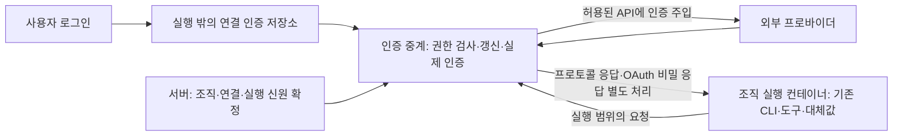

# issue-148 레퍼런스 조사: 인증 소유권과 조직 실행의 보안 경계

조사일: 2026-11-10. 대상: [#148](https://github.com/babo-jeonguk/BaboJUBot/issues/148). 원본 자격 증명 보호의 선행 설계와 적용 후보를 다룬다. 네 프로바이더의 실제 인증 호환성 검증이나 구현 완료 보고는 아니다. 보호 수준·기존 구독 유지·기존 CLI와 외부 인증 중계·단계적 지원은 아래 사용자 결정으로 확정했으며, 구체 중계 구현은 아직 미확정이다.

## Brief

- 구현할 문제: Codex·Antigravity의 연결 로그인 원본 mount, Claude의 연결 토큰 환경 변수, OpenCode의 인증 복사가 조직 실행에 계정 권한을 전달한다. 전달 형식 변경에 그치지 않고 인증 소유자와 임의 코드 실행의 경계를 검토한다.
- 동종 문제: 신뢰하지 않는 프로그램이 외부 API를 사용해야 하지만 계정 원본을 얻거나 다른 작업의 권한을 행사해서는 안 되는 상황.
- 확정한 위협 가정: 조직 실행 컨테이너 전체가 장악되어도 계정 로그인 원본·갱신 토큰을 가져갈 수 없어야 한다. 외부 인증 영역은 장악되지 않았다고 가정하며, 호스트·커널·중계 자체의 침해까지 보호한다는 보장은 아니다.
- 고정된 제품 조건: 조직 경계·초기 연구 승인·최종 완료는 코드가 강제한다. ADR-0001의 기존 CLI adapter 제어면에서 출발하며, 자체 agent loop 전환을 선결정하지 않는다. 과거 로그인 공유 결정은 재검토 대상이다. 실제 자격 증명·로그인·유료 API·모델 호출은 사용하지 않았다.
- 제품 기준: `8c47977d2140a4aeebc516259541a1b821f0dde1`. 이전 대화의 `c88a98b` 진단 3개 실패·기존 검사 42개 통과는 과거 제품 근거이며 이번 upstream 검사에 합산하지 않는다.

| ID | 조사 질문 | 출처 | 전략 |
|---|---|---|---|
| Q1 | 유명 프로젝트의 인증 보관과 코드 실행 경계는 어디인가? | 사용자 선행 사례 요청, #148 현상 | Source Recon + 공격 시나리오 |
| Q2 | 외부 중계가 호출자·목적지·요청 위치를 어떻게 제한하는가? | #148 기대 동작, #149 | Source Recon + 프로토콜·권한 |
| Q3 | 갱신·철회·종료·재시작의 소유자는 누구인가? | #148 동시 갱신 요구 | Source Recon + 수명·복구 |
| Q4 | 네 CLI의 API 키 중계와 기존 구독 OAuth는 각각 가능한가? | #148 수정 후보, ADR-0001 | 공식 문서 + 공개 인증 소스 |
| Q5 | 통상적인 설계 원칙과 단순 주입·사본·단기 토큰의 차이는? | 사용자 업계 표준 요청 | 1차 명세·구현·반례 비교 |
| Q6 | #146·#149 및 인접 이슈는 어떻게 조정해야 하는가? | 사용자 진행 순서 확인 | 현행 이슈·구조 대조 |

| 재사용한 조사 | 쓰는 범위 | 재확인 |
|---|---|---|
| [조직 제품 폴더 조사](org-product-folders-references.md#사용자-결정-2026-11-06) | 과거 공유 로그인 결정과 원본/조직 상태 분리 | 역사적 결정으로 사용. 최신 upstream 보장의 근거로 승격하지 않음 |
| [격리 조사](executor-isolation-references.md), [#102](issue-102-references.md) | 외부 네트워크·mount 경계와 host 모드 한계 | 현재 container/process 경로와 비교. Docker 전면 공격 검증으로 재사용하지 않음 |
| [#146 조사](issue-146-references.md) | 로그인 준비 직렬화·fallback·공유 mount 유지 | 이슈 본문·receipt 재독. grant 갱신 broker는 별도 후속으로 남아 있음 |

## 사용자 결정 — 2026-11-10~11

triage 설계 토의에서 사용자가 Q1·Q2에 “둘 다 예”, Q3·Q4와 Q5·Q6에 각각 “모두 예”, Q7에 “예”(2026-11-11)로 확정했다. Q8에서는 단일 프로바이더 우선 제안을 대신하여 네 프로바이더 병렬 검증·공통 경로 우선으로 정했다. 이후 설계 결정은 [누적 설계 댓글](https://github.com/babo-jeonguk/BaboJUBot/issues/148#issuecomment-6775097013) 하나를 갱신해 기록한다.

1. 보호 수준: 조직 실행 컨테이너 전체가 장악되어도 계정 로그인 원본과 갱신 토큰을 얻지 못해야 한다. 실제 자격 증명은 실행 컨테이너 밖에서 관리하고, 실행에 주어진 권한 자체가 악용될 수 있다는 한계는 별도로 다룬다.
2. 기존 구독 유지: 현재 사용하는 구독 로그인 방식을 필수 조건으로 보존한다. API 키 사용을 구독 호환의 대체로 간주하거나 별도 API 과금으로 묵시적으로 전환하지 않는다.
3. 기본 구조: 기존 CLI를 유지하고 실행 컨테이너 밖의 인증 중계가 로그인·갱신·요청 인증을 담당한다. 구독 호환성 검증에서 이 기본안으로 해결할 수 없는 부분이 확인되면 구조를 다시 토의한다.
4. 단계적 지원: 기존 구독 호환성과 보호 수준을 검증한 프로바이더부터 순차 지원한다. 아직 검증하지 못한 프로바이더는 강화된 격리 실행을 준비되지 않은 상태로 표시하고 해당 실행을 막는다.
5. 중단 시 권한 회수: 사용자의 실행 중단 요청이 효력을 갖는 시점부터 신규 모델 요청을 거부하고 진행 중인 응답 스트림을 끊는다. 서버 재시작 뒤 이전 실행 권한은 재사용하지 않는다. 이미 외부 서비스가 처리한 요청·사용한 구독 한도를 되돌리는 보장은 아니다.
6. 중계 장애: 인증 중계 고장이나 로그인 갱신 실패 시 현재 실행은 명확한 이유와 함께 실패로 끝내고 연결을 준비되지 않은 상태로 표시한다. 복구 전 새 실행을 차단하며, 진행 중이던 모델 요청을 자동 재전송하지 않는다. 사용자가 원인을 확인하고 다시 실행할 수 있게 한다.
7. 중계 방식(2026-11-11): CLI가 제공하는 서버 주소 변경 기능으로 인증 중계에 연결하는 방식부터 구현·검증한다. HTTPS 통신을 복호화해 가로채는 투명 중계는 필요성이 확인될 때 별도로 검토한다. 명시적 주소 방식의 구독 호환성을 검증하지 못한 프로바이더는 Q4에 따라 준비되지 않은 상태로 유지한다.
8. 검증·구조(2026-11-11): Codex·Claude·OpenCode·Antigravity를 같은 검증 단계에서 병렬로 다룬다. 공통 인증 중계 경로에 프로바이더별 특이점을 연결하는 구조를 우선하며, OpenCode Go만 먼저 검증하는 제안은 채택하지 않는다. 공통 경로로 처리하기 어려운 구체적 제약이 구현·검증에서 드러나면 근거와 대안을 놓고 별도 경로를 검토한다. 병렬 검증은 Q4의 검증 완료 여부에 따른 지원 개방과 별개다.

따라서 구독 호환이 확인되지 않은 경로를 원본 자격 증명 직접 전달로 우회하지 않는다. 구체 중계 제품·라이브러리, 미지원 안내의 세부 화면과 이유 코드, 권한의 신원 결합·만료·진행 중 요청 정리의 구현과 배포 단위는 아직 확정하지 않았다. 중계 방식의 우선순위와 중단·재시작·장애 시의 외부 동작은 위 결정으로 확정했다. 이 결정은 실제 자격 증명 사용·로그인·모델 호출·비용 발생 검증에 대한 승인이 아니다.

## 레퍼런스

조사자 세 명이 orchestration / sandbox·egress / 보안·신원의 관점을 병렬 조사하고 메인이 공식 CLI 문서·원문 재열람·합성 재실행을 맡았다. 유명 프로젝트와 직접적인 소규모 구현을 구별했다. 이름 인지도나 GitHub 별 개수는 보안 보장의 근거로 사용하지 않았다.

| 레퍼런스 | 분류 | 고정 SHA | 라이선스 | 깊이·선정 이유 |
|---|---|---|---|---|
| Paperclip | CLI orchestration OSS | `98ce93dd4e56182071e8dfd2f9c046f3d819102c` | MIT | 소스·테스트 읽기; 가까운 구조의 인증 복사/copy-back 반례 |
| OpenHands software-agent-sdk | agent SDK OSS | `ca00c36ec32aefc2f64cca4d74f6d0210b8783d7` | MIT | 소스·테스트 읽기; remote agent-server와 raw credential 전달 |
| SWE-agent / SWE-ReX | coding-agent·실행 엔진 OSS | `3ea751c087f32b16e039a2233dd6eefecef325d5` / `5c995c365dfb1fd5bc56fda688be5d8538f9931f` | MIT | 소스; 모델 제어부와 shell 실행부 분리 |
| NanoClaw | 개인 agent orchestration OSS | `97ad69bd06a39106321b91ce94e6cf986b42a7ff` | MIT | 소스·문서; 그룹별 외부 gateway와 시작 거부 |
| NVIDIA OpenShell | 보안 실행 runtime OSS | `22209de7503ba0d2f89b24aa1edf6f9edf0f1b73` | Apache-2.0 | 소스·테스트 읽기; 별도 supervisor, endpoint/placement/epoch |
| Anthropic sandbox-runtime | sandbox 부품 OSS | `f7a0f19fd3b4437bcf808f9c18c1f73e9f1a9889` | Apache-2.0 | 소스·registry 합성 실행; sentinel과 실패 시 원본 노출 경로 |
| OpenSandbox | sandbox 플랫폼 OSS | `97d51cb887761a40b99b136fce93879879c251fc` | Apache-2.0 | 소스·addon 테스트 실행; 외부 vault와 응답 body 한계 |
| Codex responses-api-proxy | 공식 OSS 부품 | `627b579219d492b5445d6d433d3110eb53e507dc` | Apache-2.0 | 소스·테스트 읽기; 고정 API에만 인증 주입 |
| Docker Sandboxes | 공식 제품 문서 | docs `f5b68c4b1586fb4498565fec926c3a778d263552` | docs Apache-2.0; runtime 라이선스와 별개 | 문서; OAuth access/refresh 응답까지 sentinel 처리 |

각 심층 OSS의 root LICENSE를 읽었다. 설계 참고이며 외부 코드를 제품에 복사하거나 의존성을 추가하지 않았다. NanoClaw는 GitHub API에서 옛 `qwibitai/nanoclaw`가 `nanocoai/nanoclaw`로 응답하는 정식 저장소를 확인했다. 단순 동명 fork로 취급하지 않았다.

추가 후보: Exo(MIT, under construction), agentcordon(AGPL-3.0-only), 작은 agent-proxy(MIT), E2B SDK/runtime(Apache-2.0), Kubernetes Agent Sandbox(Apache-2.0), Modal credential recipe, OpenClaw Enterprise 설계 문서, mini-swe-agent, nono, Stockade, Vault, SPIFFE·RFC 8693. 작은 구현·검색 발견·초안만으로 성숙한 실행 보장을 주장하지 않았다. Vault 현재 BSL-1.1은 OSI OSS로 분류하지 않았다. Daytona의 조회 snapshot은 archived/README 중심이고 `microsoft/agent-sandbox` 조회는 404여서 이 경로들을 구현 근거로 채택하지 않았다.

무자격 실행 경로: srt registry는 Node 직접 import, OpenSandbox addon은 stdlib stub 테스트가 가능해 실행했다. SWE-agent는 PredeterminedTestModel+dummy runtime, Paperclip은 합성 파일 단위 검사, OpenHands는 mock LLM+Docker agent-server 경로가 후보이나 설치·전체 실행은 하지 않았다. OpenShell·Codex proxy·Exo는 Rust 및 runtime 환경 준비가 필요해 소스 확인에 한정했다. Docker·Modal의 계정/설치 경로는 실행하지 않았다.

Discovery 범위: orchestration은 네 라운드 중 마지막에 선정 세 프로젝트의 copy-back/materialize/원격 실행 변형만 반복했다. sandbox 관점은 세 라운드에서 외부 주입·egress·응답·회수의 변형을 확인했다. 보안 관점은 sentinel/동적 발급/workload identity/supervisor를 구분했다. 포화는 이 비교 범위의 국소 판단이며 전 세계 OSS·표준을 전수 조사했다는 뜻이 아니다. 검색 발견만 한 추가 후보는 채택 근거에서 제외했다.

## 근거

| ID | 관찰 | 출처 | 수준 |
|---|---|---|---|
| E01 | Paperclip은 symlink auth를 실체화해 sandbox asset으로 보내고 갱신본을 host로 copy-back한다. 계정 원본 비노출 사례가 아니다 | [execute staging/copy-back](https://github.com/paperclipai/paperclip/blob/98ce93dd4e56182071e8dfd2f9c046f3d819102c/packages/adapters/codex-local/src/server/execute.ts#L844-L907) | 소스 확인 |
| E02 | OpenHands의 확인한 RemoteConversation 경로는 `expose_secrets=True`로 agent를 remote server에 전달한다. 다른 모든 배치를 뜻하지 않는다 | [payload 생성](https://github.com/OpenHands/software-agent-sdk/blob/ca00c36ec32aefc2f64cca4d74f6d0210b8783d7/openhands-sdk/openhands/sdk/conversation/impl/remote_conversation.py#L908-L977) | 소스 확인 |
| E03 | SWE-agent의 모델 호출은 controller의 LiteLLM, action은 환경 실행으로 간다. SWE-ReX는 별도 Docker runtime에 RPC token을 사용한다. 사용자 mount/env로 비밀을 넣으면 이 분리가 깨질 수 있다 | [model](https://github.com/SWE-agent/SWE-agent/blob/3ea751c087f32b16e039a2233dd6eefecef325d5/sweagent/agent/models.py#L704-L741), [action](https://github.com/SWE-agent/SWE-agent/blob/3ea751c087f32b16e039a2233dd6eefecef325d5/sweagent/agent/agents.py#L936-L979), [Docker RPC](https://github.com/SWE-agent/SWE-ReX/blob/5c995c365dfb1fd5bc56fda688be5d8538f9931f/src/swerex/deployment/docker.py#L233-L283) | 소스 확인 |
| E04 | NanoClaw는 gateway가 자격 증명을 소유한다고 문서화한다. 코드에는 그룹/세션 신원으로 ensure하고, availability/generation 변경 시 시작 거부·기존 세션 중단 경로가 있다. gateway provider 전체 검증은 아님 | [보안 문서](https://github.com/nanocoai/nanoclaw/blob/97ad69bd06a39106321b91ce94e6cf986b42a7ff/docs/SECURITY.md#L127-L164), [실행·신원](https://github.com/nanocoai/nanoclaw/blob/97ad69bd06a39106321b91ce94e6cf986b42a7ff/src/container-runner.ts#L477-L530), [시작 거부](https://github.com/nanocoai/nanoclaw/blob/97ad69bd06a39106321b91ce94e6cf986b42a7ff/src/container-runner.ts#L555-L567) | 소스 확인·문서 주장 |
| E05 | OpenShell Docker driver는 workload network=none을 검사하고 supervisor를 별도 컨테이너로 만든다. 같은 조직 컨테이너 안의 보조 프로세스와 다른 경계다 | [외곽 검사](https://github.com/NVIDIA/OpenShell/blob/22209de7503ba0d2f89b24aa1edf6f9edf0f1b73/crates/openshell-driver-docker/src/lib.rs#L3115-L3143), [supervisor 생성](https://github.com/NVIDIA/OpenShell/blob/22209de7503ba0d2f89b24aa1edf6f9edf0f1b73/crates/openshell-driver-docker/src/lib.rs#L5544-L5567) | 소스 확인 |
| E06 | OpenShell은 host/port/path와 주입 위치를 구분하며 mismatch를 403으로 거부한다. token rotation과 권한 epoch 변경도 구별한다 | [endpoint resolver](https://github.com/NVIDIA/OpenShell/blob/22209de7503ba0d2f89b24aa1edf6f9edf0f1b73/crates/openshell-core/src/provider_credentials.rs#L352-L473), [placement 거부](https://github.com/NVIDIA/OpenShell/blob/22209de7503ba0d2f89b24aa1edf6f9edf0f1b73/crates/openshell-supervisor-network/src/l7/relay.rs#L595-L656), [epoch 테스트](https://github.com/NVIDIA/OpenShell/blob/22209de7503ba0d2f89b24aa1edf6f9edf0f1b73/crates/openshell-core/src/provider_credentials.rs#L2858-L2932) | 소스 확인; Rust 테스트 미실행 |
| E07 | srt registry는 credential별 host 제한·rotation·clear를 구현한다. 허용 host의 임의 header에도 치환하므로 허용 API의 echo 기능을 별도 검토해야 한다 | [registry](https://github.com/anthropics/sandbox-runtime/blob/f7a0f19fd3b4437bcf808f9c18c1f73e9f1a9889/src/sandbox/credential-sentinel.ts#L50-L106), [headers](https://github.com/anthropics/sandbox-runtime/blob/f7a0f19fd3b4437bcf808f9c18c1f73e9f1a9889/src/sandbox/credential-sentinel.ts#L193-L248) | 소스 확인·합성 실행 확인(6검사) |
| E08 | srt extract 실패 기본 warn과 일부 JWT 실패는 원본 env를 상속하는 fail-open 경로다. injectHosts 생략 시 allowedDomains 전체가 주입 대상이다 | [mask env](https://github.com/anthropics/sandbox-runtime/blob/f7a0f19fd3b4437bcf808f9c18c1f73e9f1a9889/src/sandbox/credential-mask-env.ts#L46-L113) | 소스 확인 |
| E09 | OpenSandbox는 requestheaders에서 범위에 맞는 인증을 넣으며 lookup 오류는 거부한다. 스트리밍 전에 주입한다 | [hook](https://github.com/alibaba/OpenSandbox/blob/97d51cb887761a40b99b136fce93879879c251fc/components/egress/mitmscripts/system.py#L1871-L1911), [binding](https://github.com/alibaba/OpenSandbox/blob/97d51cb887761a40b99b136fce93879879c251fc/components/egress/mitmscripts/system.py#L2071-L2130) | 소스 확인·합성 실행 확인 |
| E10 | OpenSandbox 응답 header redaction은 body를 바꾸지 않는다. upstream echo의 비밀 body가 그대로 돌아오는 테스트도 통과한다. 일반적인 OAuth 응답 은닉 보장이 아니다 | [실제 upstream test](https://github.com/alibaba/OpenSandbox/blob/97d51cb887761a40b99b136fce93879879c251fc/components/egress/tests/test_mitmscripts_system.py#L1201-L1214) | 소스 확인·합성 실행 확인 |
| E11 | Docker 문서는 OAuth token 응답의 access/refresh를 sentinel로 바꾸며 passthrough는 예외라고 설명한다. API 키 주입과 OAuth 응답 처리는 별도 책임이다 | [kit OAuth 정의](https://github.com/docker/docs/blob/f5b68c4b1586fb4498565fec926c3a778d263552/content/manuals/ai/sandboxes/customize/kits-v2.md#L363-L380) | 문서 주장; runtime 미실행 |
| E12 | Codex 공식 proxy는 exact POST /v1/responses만 받고 고정 upstream에 host 인증을 넣는다. loopback listener만으로 다조직 권한·회수가 완성되는 것은 아니다 | [proxy gate/인증](https://github.com/openai/codex/blob/627b579219d492b5445d6d433d3110eb53e507dc/codex-rs/responses-api-proxy/src/lib.rs#L229-L306) | 소스 확인 |
| E13 | OpenAI는 application key를 실행 환경 밖에 두고 제한된 executor key와 외부 인증 중계를 구별한다 | [공식 sandbox security](https://developers.openai.com/api/docs/guides/agents-api/environments/security) | 문서 주장 |
| E14 | RFC 8693은 실제 token exchange 표준이다. provider 지원과 입력/출력 token의 수명·철회 전파를 자동 보장하지 않는다 | [RFC 8693 §2.1](https://www.rfc-editor.org/rfc/rfc8693.html#section-2.1) | 명세 주장 |

## 패턴

| ID | 패턴 | 사례 | 장점 | 비용·실패 모드 |
|---|---|---|---|---|
| P01 | 인증을 가진 controller와 작업 executor 분리 | E03 | 모델 원본이 작업 컨테이너에 필요 없음 | 기존 CLI의 내장 파일·셸·hook·plugin·하위 agent까지 모두 위임할 수 있어야 함 |
| P02 | CLI는 실행 안에, 외부 proxy가 인증 소유 | E04–E07, E09, E11–E13 | 기존 CLI·세션·프로토콜을 유지할 여지 | endpoint·권한·egress·TLS/스트림·OAuth adapter 유지 비용 |
| P03 | 실행에 실제 비밀 전달: 사본·env·파일·동적 token | E01–E02, Vault 비교 | 기존 인증 흐름에 쉽게 연결 | 읽을 수 있는 권한은 남음. 원본 refresh 보호와 access token 탈취 방지는 구별 |
| P04 | workload 신원과 provider 계정 신원 분리 | E04, E06, E13–E14 | 실행별 권한·개별 회수 가능 | 로컬 중계 권한은 provider가 발급한 scoped token이 아님. 유효한 실행 권한 자체는 악용 가능 |

“유일한 업계 표준 구현”은 확인하지 못했다. 반복 확인한 보안 원칙은 신뢰 경계 분리·최소 권한·외부 정책 강제·명시적 수명이다. gateway/supervisor는 이 원칙을 구현하는 선행 패턴이며 모든 제품에 그대로 꽂는 표준 프로토콜은 아니다. Vault의 단기 secret과 SPIFFE workload identity는 보조 부품이다. 수신자가 credential을 읽을 수 없게 만드는 대체품으로 취급하지 않는다.

## 결정 권고

| ID | 권고 | 내용 | 근거·이유 | 질문 |
|---|---|---|---|---|
| D01 | 채택 권고 | 인증 원본·refresh writer는 조직 실행 밖 신뢰 영역 하나가 소유 | P01–P04; 계정 원본과 작업 권한 분리 | Q1·Q3·Q5 |
| D02 | 변형 채택 권고 | 현재 CLI adapter를 유지하고 외부 인증 중계를 우선 타당성 검증 | P02, ADR-0001; 자체 loop 재구축을 피할 가능성 | Q1·Q4 |
| D03 | 채택 권고 | 중계 권한을 연결·조직·실행·서비스·허용 작업·만료에 묶고 외부에서 검사 | E04·E06·E12; body의 organizationId를 신원으로 믿지 않음 | Q2·Q3 |
| D04 | 채택 권고 | `HTTP_PROXY` 설정과 별도로 우회 불가능한 egress·mount·프로세스 경계 검증 | E05, #149; 원본이 같은 컨테이너의 부모 프로세스에 있어도 목표 미달 | Q2·Q6 |
| D05 | 채택 권고 | provider별 요청 endpoint·주입 위치·응답·refresh를 검증하고 실패 시 실행 거부 | E06·E08·E10·E11; host allowlist/문자열 redaction만으로 부족 | Q2·Q4 |
| D06 | 채택 권고 | token rotation과 실행 권한 철회를 구별하고 중단·재시작 뒤 stale 권한을 거부 | E04·E06; 원본 refresh는 host 소유, 조직의 auth copy-back 금지 후보 | Q3 |
| D07 | 배제 | RO mount·파일 대신 env·조직별 사본·상한 1만으로 해결 선언 | P03; 읽기·원본 grant 범위는 그대로 | Q1·Q5 |
| D08 | 보류 | 자체 loop 전환, 모든 CLI용 투명 TLS 중계, OAuth token exchange·Vault·SPIFFE 제품 채택 | provider 호환성과 운영 복잡도 근거 부족 | Q4·Q5 |
| D09 | 채택 권고 | #148/#149 경계를 먼저 정하고 #146 명세의 공유 로그인 전달 부분을 조정 | 현재 #146은 원본 공유 mount를 유지하는 별도 리팩터링 | Q6 |

### 적용 후보 구조

이 그림은 논의안이다. 실행별 중계 token/handle도 유효기간 중 권한을 가진 민감한 값이다. 계정 원본 비밀이 아니라는 이유로 로그에 공개하거나 무제한 공유하지 않는다. bearer를 훔치면 실행 중 허용 작업을 할 수 있으므로 출발 runtime 신원과 권한을 결합하고 철회·남용 제한을 검증해야 한다. 계정 자격 증명 은닉은 연구 데이터 외부 반출·허용된 API 사용의 남용까지 자동으로 막지 않는다.

### 네 CLI의 호환성 근거

| 프로바이더 | 확인한 진입점 | 아직 확인하지 않은 것 |
|---|---|---|
| Codex | [공식 custom model provider/base_url](https://learn.chatgpt.com/docs/config-file/config-advanced), E12 proxy | 기존 ChatGPT 구독·모델 목록·사용량·세션·스트리밍을 유지하는 중계. app-server 외부 token bridge도 CLI에 실제 access token을 주므로 이것만으로 전체 컨테이너 보호가 되지 않음 |
| Claude Code | [공식 gateway](https://code.claude.com/docs/en/llm-gateway), [연결 설정](https://code.claude.com/docs/en/llm-gateway-connect): BASE_URL와 gateway credential | 기존 setup-token 구독과의 동일성, OAuth rotation·세션 기능. API key gateway로 바꾸는 것은 인증/과금 경로 선택 변경임 |
| OpenCode | [공식 V2 providers](https://opencode.ai/docs/providers): `providers.<id>.settings.baseURL`, package별 설정 | 현재 OpenCode Go 계정·조직 DB·model ID·사용량 보존. 옛 V1 auth.json 문서와 현재 DB 구조 혼동 금지 |
| Antigravity | [공식 Authenticate](https://antigravity.google/docs/install?tab=cli): API키 `modelProvider=gemini`, `GOOGLE_GEMINI_BASE_URL` | 기본 signed-in 계정 OAuth를 같은 설정으로 중계할 수 있는지, 현재 설치 판의 실제 지원·사용량·프로토콜 |

네 CLI 모두에 “API gateway 설정이 있으니 기존 구독도 그대로 된다”고 일반화할 수 없다. Docker의 OAuth masking은 가능성의 선례이며 우리 설치 판과 계정에 대한 검증을 대신하지 않는다. API 키로 묵시적으로 전환해 다른 과금으로 실행하지 않는다.

### 후속 기술 확인 — 기존 구독 중계 계약

사용자 요청으로 사용량 제한에 멈췄던 두 조사자를 **기존 ID로 재개**했다. 완료했던 검색·실행을 반복하지 않고 저장 진행분을 이어갔다. 메인은 OpenCode 조사와 원문·저장된 mock 결과 대조를 맡았다. 아래는 지원 완료 판정이 아니다.

| 대상 | 이번 확인 | 중계 설계에 주는 의미·남은 검증 |
|---|---|---|
| Codex 0.167.0 | 빈 임시 HOME/CODEX_HOME, 합성 JWT·빈 refresh, 로컬 mock으로 initialize/model-list 실행. login·turn RPC는 보내지 않음. custom provider에서 합성 account header와 bearer가 로컬 `/backend-api/codex/models`로 전달됨 | 명시적 endpoint 중계의 진입점은 확인. mock이 빈 목록을 줘도 내장 모델 12개가 반환돼 모델 목록 성공은 로그인·구독 권한 증거가 아님. account check·plugin GET 등 보조 경로는 별도로 좁혀야 함. 실제 모델·갱신·SSE/WebSocket·usage·세션·구독은 미검증 |
| Claude Code 2.1.322 | 빈 HOME의 도움말·버전 및 공식 문서 확인. `CLAUDE_CODE_OAUTH_TOKEN`은 access token이며 refresh token과 다름. [gateway protocol](https://code.claude.com/docs/en/llm-gateway-protocol#request-headers)은 gateway credential 없이 BASE_URL과 claude.ai login 병용을 설명 | 투명 TLS 복호화가 반드시 필요하다는 결론은 배제. 실행에 합성 OAuth 대체값을 주고 외부 중계가 원본 access token을 붙이는 후보를 검증할 수 있음. 실제 CLI 모델 통신·구독·보조 요청·만료는 아직 미검증 |
| OpenCode 2.2.6 / Go | 빈 HOME 버전·도움말 확인. [Go 공식 문서](https://opencode.ai/docs/console/go/)는 구독 상품이 API key를 발급한다고 설명. 일치하는 v2.2.6 소스는 기존 provider 설정·credential을 모델 패키지에 전달 | 키 형식과 과금 경로를 구별해야 함. 기존 Go의 계정·endpoint·model·세션 header를 유지하는 중계는 별도 종량제 provider 전환과 다름. placeholder·wire·스트리밍·usage·실제 한도 차감 미검증. provider 계정의 Extra Usage 설정까지 endpoint 보존만으로 입증하지 않음 |
| Antigravity 1.5.4 | 빈 HOME 도움말·버전 및 공식 Authenticate/Settings 확인. signed-in 계정은 shared harness, Gemini API key+BASE_URL은 별도 모드. 공개 repo는 인증 transport 구현이 아님 | signed-in endpoint override·TLS trust·refresh·stream 계약 미확인. `customModelsConfig`나 terminal `sandboxProxy`를 모델 구독 중계 지원으로 오인하지 않음. 강화 격리 지원을 완료로 표시할 수 없음 |

추가 고정 소스:

- Codex rust-v0.167.0 태그 `086ccc833bc9cf01024ad2dd6af7dbd421b6bf9a`와 설치 CLI 판을 구별해 추적했다. 기존 최신 SHA `627b579…`의 설명만으로 설치 판 지원을 단정하지 않았다.
- OpenCode v2.2.6 `dc2ffcf8bf26f9e669b6aa22b95f50e12be15e06`, MIT: [credential→model settings](https://github.com/anomalyco/opencode/blob/dc2ffcf8bf26f9e669b6aa22b95f50e12be15e06/packages/core/src/model-resolver.ts#L280-L303), [key/OAuth 구별](https://github.com/anomalyco/opencode/blob/dc2ffcf8bf26f9e669b6aa22b95f50e12be15e06/packages/core/src/model-resolver.ts#L395-L420), [native retry](https://github.com/anomalyco/opencode/blob/dc2ffcf8bf26f9e669b6aa22b95f50e12be15e06/packages/core/src/model-retry.ts#L21-L75).
- Claude [환경 변수](https://code.claude.com/docs/en/env-vars)·[gateway protocol](https://code.claude.com/docs/en/llm-gateway-protocol): OAuth access token·인증 우선순위·OAuth beta 및 session header·native retry/fallback을 provider별 검증 대상으로 삼는다. 설치 판 일치 고정 소스가 아니라 공식 최신 문서라는 수준을 유지한다.

**Q6 강제 방식의 기술 권고:** broker/refresh 실패가 fatal로 판정되면 해당 실행 권한을 먼저 무효화하고 준비 상태를 닫은 뒤 stream·CLI를 중단한다. CLI가 자체 retry/fallback을 해도 무효화된 권한으로 upstream에 재진입할 수 없어야 한다. broker 재시작에는 이전 실행 권한을 복원하지 않는 boot epoch/실행 상태 검사가 필요하다. 이는 중계 장애·갱신 실패의 동작을 구현하는 후보이며 성공한 사전 갱신이나 모든 일반 429 처리를 일괄 금지하는 새 제품 결정은 아니다.

이 조사에서 제안한 명시적 endpoint 주소 변경 중계 우선·투명 TLS 복호화 별도 검토는 2026-11-11 Q7로 사용자 확정됐다. 특정 중계 구현과 프로바이더별 지원 완료를 확정한 것은 아니다. 원본 자격 증명·실제 로그인·모델 호출·구독 한도를 사용하지 않았고, 메인은 완료한 서브에이전트 실험을 재실행하지 않고 코드와 저장 결과를 직접 대조했다.

### 공통 경로와 프로바이더 차이의 책임

Q8에 따라 작은 공통 interface 뒤에서 인증·실행 권한의 불변 조건을 강제하는 module을 우선한다. 기존 `RuntimeAdapter`의 대화·도구·세션·usage 해석 책임 전체를 인증 중계에 옮기지는 않는다. 아래는 그 결정을 구현 브리프로 구체화하는 책임 배분이며 함수명·공개 타입을 확정하는 명세는 아니다.

| 공통 경로가 소유할 책임 | 프로바이더별로 연결할 실제 차이 |
|---|---|
| 신뢰된 연결·조직·실행 신원 확정, 실행 권한 발급·검사 | CLI에 넣는 합성 인증값·최소 계정 metadata 형식 |
| 허용 목적지·작업·주입 위치 검사 후 원본 인증 사용 | 모델·보조 endpoint 집합, 필수 인증/세션/header 형식 |
| 요청·응답 전달과 stream 수명, credential 비노출·오류 정규화 | protocol의 실제 차이와 credential이 생기는 응답의 처리 계약 |
| 원본 저장·접근, 연결별 갱신 직렬화, 갱신 실패 전파 | 구독 키·장기 access·회전 OAuth 등의 획득/갱신/교체 방식 |
| 중단·장애·재시작의 권한 거부, stream 정리, 준비 상태 전파 | provider 오류를 로그인 필요·일시 오류·불명 결과로 판정할 근거 |

프로바이더별 구현이 공통 권한 검사나 회수·오류 강제를 우회하는 별도 진입점을 가지지 않게 한다. 차이는 설정이나 좁은 adapter로 표현하되, 임의의 HTTP 목적지·credential 전달을 허용하는 범용 callback 묶음으로 만들지 않는다. 같은 절차를 네 번 복제한 뒤 외관만 공통 interface로 감싼 구조도 기본안이 아니다. 실제 불일치가 확인되면 모든 provider를 억지로 같은 protocol로 번역하지 않고 필요한 seam 또는 별도 경로의 범위를 검토한다.

| 병렬 검증 축 | 공통으로 적용할 동일한 계약 | 프로바이더별 관찰 |
|---|---|---|
| 인증·호환 | 원본 비노출·기존 구독 유지·신원 바꿔치기 거부 | Codex 계정/가짜 JWT/보조 요청, Claude access-token/OAuth header, OpenCode Go 구독 key, agy signed-in harness |
| 요청·결과 | 허용 목적지·주입 위치, stream/오류 전달 | 실제 모델·목록·세션·usage 형식 보존 여부 |
| 회수·복구 | stop 뒤 신규 상류 0회·stream 종료, 장애 뒤 재진입 차단, restart 뒤 old grant 거부 | CLI native retry·fallback·refresh가 공통 회수를 우회하는지 |
| 지원 판정 | 증거 수준에 맞는 준비 상태, 미검증은 강화 격리 거부 | 소스/도움말/mock/실제 CLI/Docker/실구독을 구분한 결과표 |

병렬 검증은 착수 순서를 뜻하며 모든 행이 이미 검증됐다는 뜻이 아니다. 실제 계정·로그인·모델 호출·비용 발생은 기존 승인 조건을 그대로 따른다. 불가능한 경로를 단순 API 키 전환이나 직접 원본 전달로 통과시키지 않는다.

## 구현 참고

우선 작업은 제품 구현보다 **호환성·공격 경계 검증**이다. fake credentials+mock upstream으로 각 CLI의 모델 호출·refresh·실패·세션 경로를 확인한 뒤 실제 계정 검증이 필요한 범위를 분리한다. 실제 로그인·모델 호출은 별도 권한 확인 뒤 수행한다.

- runtime: provider별 인증 전달을 외부 소유권과 실행 배치에서 분리. `container.ts`·`process.ts`·`login.ts`·provider adapter가 접점이다. 미지원 경로를 raw credential fallback으로 숨기지 않는다.
- server: 신뢰된 실행 신원으로 중계 권한 생성·종료·취소·복구. 일반 provider 동시 실행 상한과 credential refresh 직렬화는 다른 책임이다.
- #146: 조직 상태 폴더 선택·정리는 유용하나 auth 원본 mount·원본 갱신을 유지하는 계약은 재검토. 이번 조사로 상태·blocker를 바꾸지 않았다.
- #149: 외곽 egress·관리 포트·socket·mount·공유 PATH를 함께 검증. 중계 프로세스만 같은 조직 컨테이너 안에 추가하는 방식은 권고 경계가 아니다.
- #145/#141: provider 연결·취소/정리 및 종료/재시작 복구와 수명 정합성 확인. #150/#154는 복구 검증 접점. #147은 upstream 요청 거부가 관찰됐고 인증/DB 공유가 원인으로 확정되지 않아 별도 진단 유지.

| ID | 검증할 경계: 입력 → 기대 | 근거 |
|---|---|---|
| V01 | A 컨테이너의 env·파일·mount·프로세스에서 계정 원본·refresh·B 권한을 찾음 → 얻지 못함 | D01·D03·D04 |
| V02 | A 권한+B 조직 ID/연결/다른 서비스 → trusted binding 불일치 거부 | D03 |
| V03 | proxy env 해제·direct IP·IPv6/QUIC·DNS rebinding·host/metadata/관리 socket → 승인 경로 밖 인증·접근 거부 | D04, #149 |
| V04 | 허용 host의 echo/debug/token mint·잘못된 path/port/header 위치·redirect → 원본 유출 및 부적절한 인증 거부 | D05 |
| V05 | 동시 만료·늦은 401·갱신 실패·취소 → host가 회전 소유, stale 저장/자동 유료 요청 재전송 없음 | D01·D06 |
| V06 | 실행 종료/중단·권한 삭제·재시작·keepalive/stream → 신규 요청 거부, stale 권한 재사용 불가; 이미 upstream에 전송된 작업은 별도 취소 한계 명시 | D06 |
| V07 | 중계 timeout·vault 소실·mask 실패·미지원 로그인 → 인증 필요/실행 불가를 관찰 가능하게 반환, raw 원본 fallback 없음 | D05 |
| V08 | 인증 없는 fake/local 실행 → 자격 증명·중계 권한 미제공 | #148 기대 동작 |

| 열린 결정 | owner | 선택지·권고 |
|---|---|---|
| 기존 연결 공유의 구현 | #148 구현 | 같은 연결을 여러 조직에서 선택하는 기존 의미를 유지하되 계정 원본은 신뢰 영역에만 두고 조직/실행 권한을 분리. 원본 공유 mount·실행 결과 copy-back으로 보존하지 않음 |
| provider별 상세 계약 | #148 구현 전 검증 | 명시적 endpoint 중계 우선은 Q7, 네 대상 병렬 검증·공통 경로 우선은 Q8로 확정. 필요한 모델·보조 endpoint와 OAuth 대체값·갱신 응답 계약을 검증. 투명 TLS는 필요성 확인 시 별도 검토 |
| 미지원 provider 안내 세부 | #148 | 단계적 지원과 미검증 연결의 강화된 격리 실행 거부는 확정. 안내·이유 코드·검증된 지원 범위 표시를 구체화해야 함 |
| 구체 중계 구현·배포 단위 | #148 구현 전 검증 | OpenShell·OpenSandbox 전체 도입이나 자체 재구현을 아직 선택하지 않음. rootless·권한·추가 운영 비용 비교 필요 |
| 승인·사용량 제한 | 사용자/조직 정책 | 기존 기본 승인 꺼짐과 예산 기능 범위를 존중하면서 실행 권한 남용 한계를 명시 |

### Triage 결과 — 2026-11-11

Q1~Q8을 [같은 누적 댓글의 Agent Brief](https://github.com/babo-jeonguk/BaboJUBot/issues/148#issuecomment-6775097013)에 구현 계약으로 정리하고 #148을 `bug` / `ready-for-agent`로 전환했다. 새 설계 댓글을 추가하지 않았다. 이 전환은 제품 코드 구현·실제 구독 지원·보안 검증 완료를 뜻하지 않는다.

현재 HEAD `14ad325fbe12230730fddecbe9fc73cd4790b217`에서 원본 mount·Claude token 주입·OpenCode credential 복사 경로가 남아 있음을 다시 확인했다. 기존 거절 기록은 없으며 새 원인 진단·기존 실험을 반복하지 않았다. #141은 종료 저장/commit 뒤 효과 통합으로 병합됐으므로 구현 시 현재 계약을 재사용한다.

프로바이더별 상세 endpoint·내부 타입·라이브러리·배포 단위는 구현자가 위 강제를 만족하도록 정할 항목이다. 구독 보존·공통 경로·보호 수준을 바꿔야 하는 사실이 나오면 사용자 판단으로 되돌린다. 실제 계정 검증은 별도 권한을 확인한 뒤만 진행하며, 권한/증거가 없으면 해당 강화 격리 조합은 준비안됨으로 유지한다.

#149의 확정 네트워크·mount·시작 환경 계약과 통합하기 전 전체 컨테이너 보호를 완료로 표시하지 않는다. #146은 여전히 원본 공유 mount 유지 전제로 작성돼 있어 별도 명세 정합이 필요하다. 이번 triage에서 #146 본문·라벨·blocker를 변경하거나 작업을 흡수/폐기하지 않았다.

## 구현 기록 — 1단계 (2026-11-11)

기준: `origin/main` `89f6abb`. 이 단계는 공통 인증 중계와 원본 비전달을 만든 것이며 네 프로바이더 지원 완료가 아니다.

- 공통 경로(`packages/runtime/src/providers/credential-relay.ts`): 실행 시도 권한 발급(연결·조직·실행 시도, 최대 12시간, 서버 메모리에만 있어 재시작 시 소멸) → 권한 확인 → 허용 메서드·경로 확인 → 그 뒤에만 원본 읽기 → 요청 쪽 인증·쿠키·전달 header 제거와 원본 인증 주입 → 고정 상류 → 응답 쿠키 제거, 3xx 거부, stream 그대로. 중단 신호에 권한을 바로 거두고 진행 중 요청을 끊는다. 원본을 읽지 못하거나 상류가 원본 로그인을 401로 거부하면 모든 권한을 먼저 거둔 뒤 연결을 실패 상태로 두고, 준비 확인이 실패할 때와 다른 로그인을 읽으면 푼다(D01·D03·D05·D06, Q5·Q6).
- 서버 관문(`apps/server/src/isolation.ts`): 격리 켜짐 + 중계 없음/미검증이면 `credential_relay_unverified`, 실패 상태면 `credential_relay_failed`로 준비안됨·실행 거부(Q4·Q6). 중계는 조직 도구 전용 listener의 `/api/relay/<연결>`에만 있다.
- 원본 비전달: 컨테이너 배치에서 공유 로그인 폴더 mount를 없앴다. Claude는 원본 토큰 변수 대신 중계 주소·권한 값만 넣고, Codex·Antigravity는 로그인 링크를 만들지 않으며, OpenCode는 로그인을 옮기지 않는다. 조직 폴더에 보통 파일·조직 DB로 남은 로그인이 있으면 시작하지 않는다(D07). 단, OpenCode 조직 DB의 남은 로그인 확인은 컨테이너 안 서버를 띄운 뒤 하므로, OpenCode 중계를 붙일 때 서버를 띄우기 전으로 앞당긴다(지금은 서버 관문이 OpenCode 격리 실행을 막는다).
- Claude adapter: 공식 gateway 경로(`ANTHROPIC_BASE_URL` + `CLAUDE_CODE_OAUTH_TOKEN`=권한). 프로필은 `POST /v1/messages`·`/v1/messages/count_tokens`만 허용한다. `verified: false`.
- PR #165 외부 리뷰 1회차 반영(2026-11-12): (1) 응답 반향 — 상류에 압축하지 않은 응답을 요청하고, 압축 응답·붙인 원본을 담은 응답 header는 넘기지 않으며, 본문에 원본이 그대로 나오면 그 앞에서 끊는다(원본 앞부분일 수 있는 끝 조각만 잡아 둠). 인코딩·잘라 낸 반향은 막지 못하며 provider별 credential-bearing 응답 계약은 각 중계를 붙일 때 정한다(V04·E10). (2) 원본을 요청에 넣을 수 없으면(잘못된 header 값) 상류 거부와 같이 연결 실패로 두고 같은 로그인으로는 풀지 않는다(Q6). (3) 조직 폴더의 로그인 흔적은 이 컴퓨터의 실행이 남긴, 원본을 가리키는 알려진 링크만 괜찮고 다른 링크·확인할 수 없는 경로는 시작 거부한다(D07). (4) `BABOJUBOT_<연결>_PASS_ENV` 변수는 격리 실행에 넘기지 않는다. 컨테이너 환경에서 원본 인증 변수를 하나씩 빼던 목록은 없앴다(Q1).

### 원문 확인

| 원문 | 확인한 것 | 적용·배제 |
|---|---|---|
| [Claude LLM gateway protocol](https://code.claude.com/docs/en/llm-gateway-protocol) (2026-11-11 열람, 문서 앞 약 3/4 원문) | claude.ai 로그인 + gateway credential 없는 `ANTHROPIC_BASE_URL`이면 `Authorization`에 로그인 토큰이 실린다. 추론은 `POST /v1/messages?beta=true`, `count_tokens`는 선택, `HEAD /api/hello`는 거부해도 된다. `anthropic-*` header·오류 본문·stream을 바꾸지 말 것, `retry-after`·`x-should-retry` 전달 | 적용: 허용 경로, header·본문 무변경 전달. 문서는 `CLAUDE_CODE_OAUTH_TOKEN`이 같은지 명시하지 않아 실제 CLI로 확인했다(아래). fast mode·WebFetch 안전 확인은 base URL이 아니라 `api.anthropic.com`으로 직접 간다고 하며 이 중계를 거치지 않는다(권한 값은 원본이 아니므로 원본 노출은 없음, 그 기능 동작은 미검증). 모델 목록 `GET /v1/models`는 요약 수준 확인이며 제품은 고정 목록을 쓰므로 허용하지 않았다 |
| [Claude env vars](https://code.claude.com/docs/en/env-vars) (일부 원문) | `ANTHROPIC_API_KEY`가 있으면 구독 대신 그 키를 쓴다 | 적용: 컨테이너에서 `ANTHROPIC_API_KEY`·`ANTHROPIC_AUTH_TOKEN`을 빼 다른 과금 경로로 바뀌지 않게 함(Q2). 인증 우선순위 전체 문서는 열지 않았다 |
| 이전 조사의 E04·E06·E12 등 | 권한 범위·epoch·고정 상류 원칙 | 이번에 원문을 다시 열지 않고 위 조사 기록을 재사용했다 |

### 합성 검증 결과

| 대상 | 실행 | 결과 | 다음 입증 조건 |
|---|---|---|---|
| Claude 2.1.322 | 수동 확인 한 번(자동 시험 아님): 실제 CLI, 빈 HOME, 합성 권한, 중계 → 로컬 모의 Messages API(SSE). 실제 계정·모델·Docker 없음. 자동 시험은 가짜 프로그램(`test-fixtures/claude-relay.mjs`)으로 같은 경로를 본다 | `--print` 한 턴 성공. 상류는 `POST /v1/messages?beta=true` 한 번, `anthropic-beta`에 `oauth-2025-04-20`(구독 OAuth 분기) 포함, 원본 합성 토큰으로 바뀌어 도착, 권한 값은 상류에 가지 않음. 기본 환경에서 `HEAD /api/hello`는 중계가 401로 거부했고 CLI는 계속 진행 | 기존 구독 계정으로 모델 한 턴·사용량·세션 이어 가기·만료 응답 확인(실제 계정·비용 승인 필요), Docker Engine에서 컨테이너 → 중계 경로 |
| Codex 0.167.0 | 2단계: 실제 CLI(app-server·exec·다른 프로세스에서 이어 가기), 빈 HOME, 합성 로그인, loopback만 있는 네트워크 이름공간, 실제 `createCredentialRelay` → 로컬 모의 상류. 자동 시험은 `codex-relay.mjs`·`codex-refresh.mjs` | 사용자 지정 provider(`requires_openai_auth`)로 ChatGPT 로그인 분기 유지, 한 턴 성공. 부가 기능을 끄면 `/models`·`/responses`와 거부해도 되는 설정 조회만 나감, WebSocket 없음. 상류에 원본 access token·계정 ID 도착, 컨테이너 파일·출력에 원본 없음. 사용량은 `response.completed` 그대로, 이어 가기는 로컬. 상류 401 → 0.3초에 `unauthorized` 실패. 갱신 값·계정 ID 없는 가짜 로그인이면 CLI는 갱신·계정 확인을 하지 않음 | 실제 구독 한 턴(chatgpt.com이 `accept-encoding: identity`를 따르는지, 구독 한도로 잡히는지), 실제 갱신 수명·회전, 도중 429·5xx, 도구·압축 턴, Docker |
| OpenCode 2.2.6 | 2단계: 실제 CLI(`serve`), 빈 XDG 폴더, 합성 Go 키, 네트워크 이름공간, 실제 중계 → 모의 상류. 자동 시험은 `opencode-simulator.mjs --relay` | `providers.<id>.settings.baseURL`로 Go(`opencode-go`)·Zen 무료(`opencode`)를 중계로, provider ID·model ID·프로토콜 유지. 권한은 설정 `apiKey`·`headers["x-api-key"]`로만(조직 DB에 저장 안 됨). OpenAI 계열은 `Authorization`, Anthropic 계열은 `x-api-key`. Zen 무료는 공개 키 그대로·비용 0. 사용량은 세션 누계로 서버 재시작 뒤에도 집계. 조직 DB에 남은 로그인은 config `apiKey`보다 앞서므로 시작 전 검사 필요(행 수만 셈, 서버 없이 확인됨). Google 계열(`gemini-*`)은 경로·키 위치가 달라 미지원 | 프로토콜 계열마다 실제 Go 한 턴(과금·남용 판정·session header 요구 여부), Zen 무료의 중계 수용, Docker |
| Antigravity 1.5.4 | 2단계: 실제 CLI(출력 모드·`agy acp`), 빈 HOME, 합성 로그인 파일, 네트워크 이름공간(세션 bus 가림), 실제 중계 → 모의 상류. 자동 시험은 ACP로 바꾼 `antigravity-simulator.mjs`와 실제 ACP 프레임(모의 상류)으로 만든 `antigravity-recorded.json` | `CLOUD_CODE_URL`이 로그인 상태로 Code Assist 호출 전체를 옮김(http 허용). 출력 모드는 고정 주소 `www.googleapis.com/oauth2/v2/userinfo` 확인 실패로 모델 호출 전에 끝남 → `agy acp`는 그 실패에도 이어져 한 턴 성공, 상류에 원본 access token만 도착. ACP: 취소 즉시 `cancelled`·상류 끊김, 실행 오류는 `end_turn`+경고 문구로만 오고 이유는 `--log-file`에만, 없는 모델은 기본 모델로 조용히 진행, 로그인 없으면 `session/new` -32000 `Authentication required`. 작업 폴더 `.agents/mcp_config.json`은 읽지 않았고 `session/new`의 `mcpServers`는 연결됨(도구가 모델에 실리는지는 모의 모델로 확인 못 함). `agy models`가 만료 로그인을 갱신해 링크를 따라 원본에 씀 | 실제 구독 한 턴(상류 호스트가 `daily-cloudcode-pa`인지, 조직 도구가 실제 모델에 실리는지), 429 기본 재시도 상한, 제목 생성 호출의 사용량, Docker |

1단계는 공통 경로와 Claude 행만 실행했고, 2단계(아래)에서 Codex·OpenCode·Antigravity 행을 병렬로 실행했다. 네 행은 합성 확인이고, 실제 구독·Docker 확인은 아래 "실제 확인" 절에 따로 적었다. 실제 확인 뒤 사용자 결정으로 네 연결의 격리 실행 지원을 열었다(2026-11-12, `verified` 기본값 참).

## 구현 기록 — 2단계 (2026-11-12)

기준: `origin/main` `9d3148f`(#165·#166 병합 뒤). 브랜치 `fix/148-relay-stage2`.

- 공통 중계: 경로마다 상류 경로(`upstreamPath`)와 인증(`authorize`)을 따로 정하고, 원본을 읽지 않는 고정 값 경로(`fixed`, OpenCode Zen 무료 모델의 공개 키)를 둔다. 반향 검사와 "같은 로그인" 판정은 원본 문서 전체가 아니라 붙인 비밀값으로 한다(Codex 로그인 파일처럼 여러 값을 담은 원본). 연결마다 계정을 고르는 header(Codex `chatgpt-account-id` 등)를 버리고, `x-goog-api-key`도 공통으로 버린다. 권한 값은 `Authorization`·`x-api-key`·`x-goog-api-key` 어디서든 찾되 서로 다른 권한 둘이면 거부한다. 권한에 조직·실행을 묶어, #149 중계가 덮어쓴 신원 header가 다르면 원본을 읽기 전에 거부한다(조직 도구와 같은 규칙, PR #165 리뷰 3회차 권고).
- 연결별: Codex·OpenCode·Antigravity를 중계에 붙였다(위 표). 권한이 든 로그인 파일은 실행 시도 전용 폴더에서 그 컨테이너에만 읽기로 넣고, 조직 폴더에는 권한 없는 자리 표시만 둔다. 같은 조직의 두 실행이 한 파일을 함께 쓰면 서로의 권한을 읽거나 지울 수 있어서다(시험으로 재현). 원본을 가리키는 링크가 남아 있으면 따라 쓰지 않고 지운다. Antigravity는 `agy acp`로 바꾸고 조직 도구를 `session/new`로 준다(사용자 결정, 2026-11-12). OpenCode Zen 무료 모델도 중계로 허용했다(사용자 결정, 2026-11-12).
- 직행 차단: 네 연결 모두 격리 실행에 프로바이더 직행 목적지(#149 `providerDestinations`)를 열지 않는다. 모델 통신은 인증 중계로만 나간다.
- 갱신(완료 조건 6): Codex·Antigravity는 중계가 원본을 읽을 때 곧 끝나면 이 컴퓨터의 공식 프로그램으로 먼저 갱신한다(Codex `app-server` `account/read`+`refreshToken`, Antigravity `agy models`). 연결마다 하나씩, 그동안 온 요청은 같은 갱신을 기다린다. 갱신 뒤에도 끝나 가면 중계 실패(Q6). Claude setup-token·OpenCode Go 키는 갱신하지 않는다. 격리를 끈 실행의 프로그램이 같은 원본을 동시에 갱신하는 경쟁은 남는다(Codex 잠금 파일은 CODEX_HOME마다 따로다).
- 되가져오기 차단: 격리를 끈 실행이 조직 폴더의 로그인 자리에 남은 보통 파일을 원본으로 옮기던 동작을 없앴다. 격리 실행의 에이전트가 거기 쓴 파일이 연결의 로그인을 덮을 수 있었다(시험으로 재현). 조직 폴더의 파일은 `<자리>.set-aside`로 치우고, 연결 폴더의 옛 로그인만 옮긴다.
- OpenCode 남은 로그인 검사를 서버를 띄우기 전으로 앞당겼다(조직 DB를 읽기 전용으로 열어 행 수만 셈, 옛 `auth.json`). 서버를 띄운 뒤의 검사도 둘째 관문으로 남겼다.
- 경쟁 시험(완료 조건 6·7): 로그인을 읽는 중의 중단, 한 조직의 중단이 다른 조직 stream에 닿지 않음, 한 실행의 로그인 거부가 다른 실행 stream을 끊음, 동시 거부, 읽는 중 거부, 같은 연결의 동시 갱신 한 번, 네 연결 공통 중단(즉시 권한 거부·상류 끊김·컨테이너를 지운 뒤 종료).

### 원문 확인 — 2단계

| 원문 | 확인한 것 | 적용·배제 |
|---|---|---|
| openai/codex `rust-v0.167.0`(`086ccc8`) `codex-rs/login/src/auth/manager.rs` L221–222·L2868–2878·L3328–3360·L3528–3546, `storage.rs` L186–215·L270–295, `storage_file.rs` L10–25, `app-server-protocol/src/protocol/v2/account.rs` L570–582 | 갱신 규칙(만료 5분 전, 없으면 8일), 계정 ID 없으면 다시 읽기·갱신 건너뜀, `account/read`+`refreshToken`이 보통 갱신 흐름을 부름, 저장은 링크를 따라간 자리에 임시 파일 rename, 잠금 파일은 CODEX_HOME마다 | 적용: 서버 갱신 방식과 규칙, 가짜 로그인 형식. 배제: OAuth 직접 구현(공식 프로그램에 맡김), `chatgptAuthTokens`(불안정 표시) |
| anomalyco/opencode v2.2.6(`dc2ffcf`) `core/src/credential/sql.ts` L5–14, `plugin/provider/opencode.ts` L416–444, `model-resolver.ts` L280–303·L395–420 | `credential` 표 모양, Zen 무료 모델이 키 없음일 때만 켜짐·공개 키, 저장된 로그인이 설정 키보다 앞섬 | 적용: 시작 전 검사·연결 DB의 Go 키 읽기, Zen에는 `x-api-key`로 권한 |
| agy 1.5.4 실행 파일 문자열(`CLOUD_CODE_URL`, `https://www.googleapis.com/oauth2/v2/userinfo`) | 주소 바꾸기 변수, 고정된 로그인 확인 주소 | 적용: `CLOUD_CODE_URL`. 배제: 출력 모드(고정 확인 주소를 옮길 수 없음) |

조사 실험의 기록과 스크립트는 저장소 밖(`/tmp/relay-probe-*`)에 두었고 실제 계정·모델 호출·비용은 쓰지 않았다.

## 실제 확인 — 2026-11-12 (C-8·C-9, 사용자 승인)

사용자가 실제 Docker와 기존 구독 계정의 실제 모델 호출을 승인했다. 확인 스크립트는 저장소에 넣지 않았다(어댑터를 직접 부르는 일회용 스크립트). 임시 제품 폴더에 실제 로그인을 링크만 하고(복사·출력 없음), 이 브랜치로 만든 공통 이미지(`babojubot-runner:relay-148`, Antigravity는 agy 1.5.4를 얹은 이미지)의 실제 컨테이너에서 실제 CLI가 #149 실행 시도 중계 → 인증 중계 → 실제 상류로 모델 한 턴을 돈다. 조직 도구는 확인용 최소 MCP 서버로 대신했다.

| 연결 | 결과 | 비고 |
|---|---|---|
| Docker 경계 | 실제 Docker 검사 9개 통과 | 방화벽을 열지 않았다. #149 이후 컨테이너는 네트워크 없이 파일 소켓으로만 통신하므로 예전 컨테이너→호스트 차단과 무관하다 |
| Codex 0.167.0 (ChatGPT 구독) | 완료. `POST /responses` 200, `GET /models` 200, `wham/settings/user`는 중계가 403으로 거부(무해). 조직 도구 호출이 실행 토큰으로 도착 | chatgpt.com이 압축하지 않은 응답 요청을 따른다(중계가 응답을 거부하지 않았다). 직접 나가려는 시도 없음 |
| OpenCode 2.2.6 Go 구독 | `deepseek-v4.1-flash` 완료(`/go/chat/completions`·`/go/responses` 200), 조직 도구 호출 도착 | `glm-5.3`은 403 "Model access is disabled"(계정 콘솔의 모델 사용 설정, 중계와 무관). 이 403을 어댑터가 로그인 필요로 보고한다(기존 판정, 별도 확인 필요) |
| OpenCode 2.2.6 Zen 무료 | 경로 확인, 실제 완료는 못 봄 | 처음에는 모델 목록 받기를 막아 내장 목록의 없어진 모델(`crouton-alpha-free`)을 골라 410 → 공개 목록 주소만 열어 고침. 그 뒤 429 `FreeUsageLimitError`. 같은 CLI를 이 컴퓨터에서 직접(중계 없이) 돌려도 같은 429였고 header가 중계 전달과 같아, 이 컴퓨터 IP의 무료 사용 한도로 판단 |
| Antigravity 1.5.4 (Google 계정) | 완료. `daily-cloudcode-pa` 상류의 `loadCodeAssist`·`fetchAvailableModels`·`streamGenerateContent` 등 8개 모두 200. 조직 도구가 ACP `session/new`로 실려 실제 모델이 호출 | 실행 전 Google 로그인 확인(`www.googleapis.com`)과 `aicode.googleapis.com`은 막혔고 실행은 이어졌다. 만료된 실제 로그인은 이 컴퓨터의 `agy models`로 갱신됐다(수동 재현, 링크를 따라 원본에 씀) |
| Claude | Claude Code 로그인(Team 구독, OAuth 접근 토큰)으로 완료. `POST /v1/messages?beta=true` 200, 세션 유지, 조직 도구 호출이 실행 토큰으로 도착 | 제품 연결의 setup-token으로는 중계를 거친 요청이 인증을 통과한 뒤 429 `rate_limit_error`였고, 중계 없이 직접 불러도 "5-hour limit"이어서 그 계정의 구독 한도로 판단했다. 같은 Bearer 형식의 접근 토큰을 다른 구독 계정으로 확인한 것이다. `api.anthropic.com` 직행 시도는 막혔다 |

확인 중 고친 것: OpenCode 격리 실행의 모델 목록 받기(위). 스크립트의 Antigravity 원본 배치 실수(원본을 링크로 두면 제품 코드가 보통 파일이 아닌 원본을 지운다)는 스크립트 문제였고 실제 로그인 파일은 그대로였다.

## 한계와 미확인

- 실행 확인: 조사 worker OpenSandbox 원문 addon suite 93 PASS. 메인이 원문 함수의 선별 정상·거부·응답 body 한계 10개를 재실행해 PASS. mitmproxy는 upstream test의 stdlib stub이므로 wire·TLS·nft·Docker 공격 E2E가 아니다.
- 실행 확인: srt의 실제 SentinelRegistry를 Node v24 TS stripping으로 import한 합성 probe 6검사 PASS. 메인도 빈 환경에서 직접 재실행했다. 다른 host 미주입·허용 host 주입·rotation·clear·임의 header 치환 한계를 포함한다. 이 검사가 실제 upstream 응답 유출을 네트워크로 재현한 것은 아니다.
- Rust/cargo 부재로 OpenShell·Codex proxy upstream 테스트는 읽기만 했다. Docker 제품·네 CLI 중계·실제 OAuth/구독·컨테이너 전체 침해·다른 OS는 실행하지 않았다. 근거 수준을 넘는 보안 보증·산업 표준 인증은 주장하지 않는다.
- 메인이 채택 근거의 원문을 재독했다. 이전 고정 SHA의 동작을 변경 없음으로 재사용하지 않고 새 snapshot을 직접 확인했다. commit/blame 전수 추적은 하지 않았다.
- 접근 실패: 추정한 Claude gateway URL은 오류 후 실제 navigation의 공식 URL로 확인했다. `docker/sandboxes`·`microsoft/agent-sandbox` 404는 그 조회 경로의 미확인이지 전체 제품의 부재나 비공개 판정이 아니다.
- 조사 단계에서는 제품 코드·테스트·설정·GLOSSARY·ADR을 변경하지 않았다. 이후 변경은 위 [구현 기록](#구현-기록--1단계-2026-11-11)이 다룬다. GLOSSARY·ADR은 구현 1단계에서도 바꾸지 않았다.
